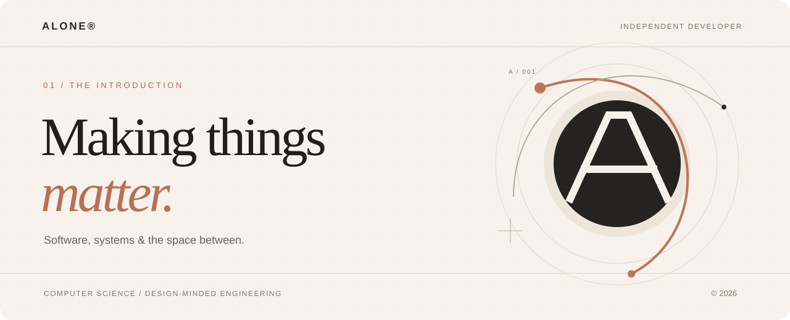
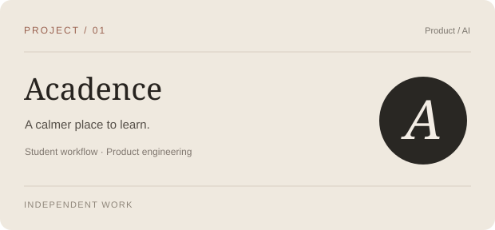
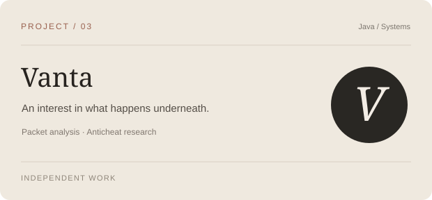
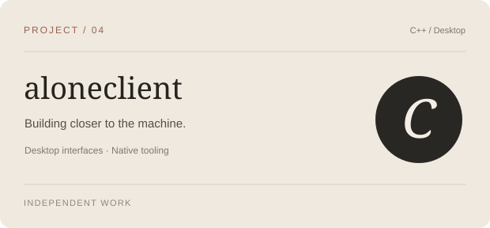
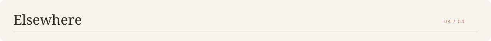

  

 

I'm **alone** - a computer science student interested in the craft behind great software. I build across the stack, from thoughtful user interfaces to backend systems and native tools. I like the details people notice *and* the ones they never see.

> My north star: make it useful, make it understandable, then make it beautiful.

 

<table>
  <tr>
    <td width="50%"></td>
    <td width="50%"></td>
  </tr>
  <tr>
    <td width="50%"></td>
    <td width="50%"></td>
  </tr>
</table>

Explorations and works in progress. Some projects are not yet publicly available.

  

**Languages** &nbsp; Java · TypeScript · JavaScript · C++ · Python

**Building with** &nbsp; React · Spring Boot · Git · SQL · Linux

**Interested in** &nbsp; Systems engineering · Developer tools · Product design · AI applications

 

[**GitHub ↗**](https://github.com/crownalonedev) &nbsp;&nbsp; · &nbsp;&nbsp; [**Browse repositories ↗**](https://github.com/crownalonedev?tab=repositories) &nbsp;&nbsp; · &nbsp;&nbsp; [**SquadsSite ↗**](https://github.com/crownalonedev/SquadsSite)

 

  

